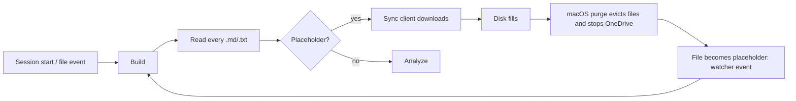
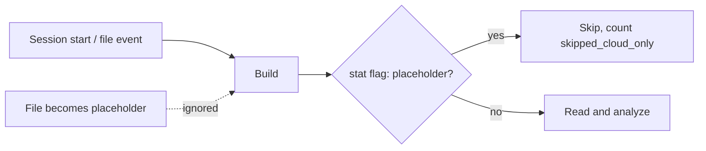

# 0.2.4

## Fixed

- **Corpus builds no longer download cloud-only files** (#8). Files that live
  only in the cloud (OneDrive, Google Drive and iCloud placeholders) are now
  found by their stat flag and skipped. They are never opened. Before this
  change, every server start read every placeholder. With one server per
  Claude session, that downloaded thousands of files, filled the disk, and
  made macOS stop OneDrive to free space.
- The watcher ignores a file that becomes a placeholder. That is the sync
  client freeing space, not an edit.
- Placeholders count toward the rule that keeps a fuller profile, so a build
  that can read only a few local files does not replace a good profile.
- The build result reports `skipped_cloud_only`.

To include a cloud folder in the corpus, mark it "Always keep on this device"
in the sync client.

## Before / After

**Before**

**After**

